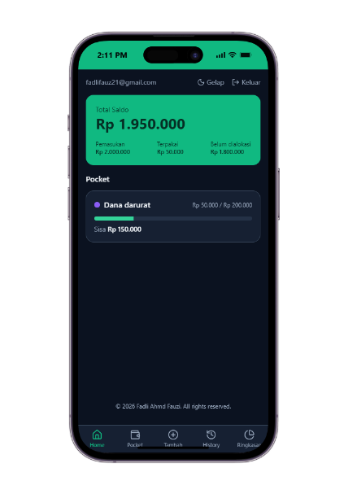
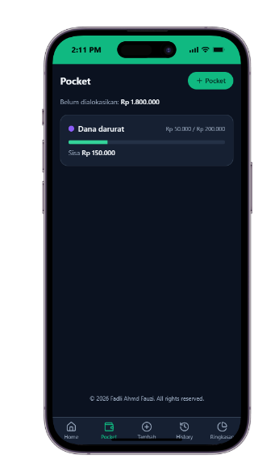
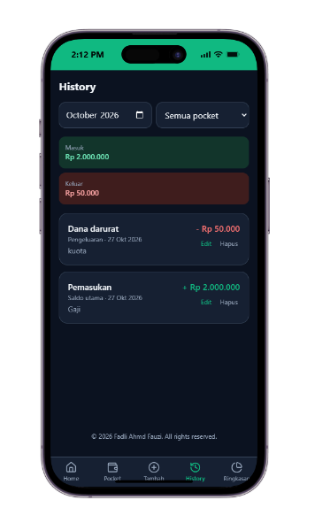
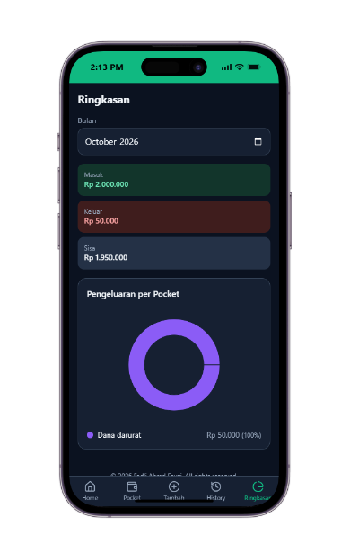

# Monthly Planner

A mobile-first web app for planning a monthly salary with **pockets**: split your income into spending categories, log every transaction, and watch each pocket's balance update automatically.

**[Live demo](https://monthly-planner-one.vercel.app/)** · Installable as a PWA · Light and dark mode

<p>
  
  
  
  
</p>

> Anyone can sign up on the demo, and each account only ever sees its own data.

## Features

- **Total balance** from recorded income, with the amount not yet allocated to a pocket
- **Custom pockets**: create, edit, and archive them; allocate by amount or percentage
- **Expense tracking** that automatically reduces the selected pocket's balance
- **Transfers** between pockets
- **History** filtered by month and pocket, with income and expense totals
- **Monthly summary** with an expense breakdown chart per pocket
- **Auth**: email and password, with data isolated per user
- **PWA**: installable on a phone's home screen
- **Light, dark, and system themes**
- **Accessible**: semantic HTML, keyboard navigation, focus-managed dialogs, skip link

## Tech stack

| Layer | Choice |
|---|---|
| Frontend | React 19, Vite, JavaScript |
| Styling | Tailwind CSS v4 with semantic color tokens |
| Routing | React Router |
| Backend | Supabase (Auth, Postgres, Row Level Security) |
| Charts | Recharts |
| Testing | Vitest |
| Hosting | Vercel |

## Design decisions

- **Balances are derived, not stored.** A pocket's balance is computed from its allocation and its transactions, so history and balances can never drift out of sync. See `src/utils/calculateBalance.js`.
- **Security lives in the database.** Row Level Security policies guarantee a user can only read or write their own rows, even when calling the API directly. Check constraints enforce valid transaction shapes. See `supabase/schema.sql`.
- **Pockets are archived, not deleted,** once they have transactions (`on delete restrict`), so history stays intact.
- **Layered structure.** UI components call hooks, hooks read context, and context talks to services. Only `src/services/` knows about Supabase.
- **Theming through tokens.** Components use semantic classes like `bg-surface` and `text-fg-muted`. Dark mode swaps CSS variables, so no component needs `dark:` variants.

## Project structure

```
src/
├── components/   # layout, pocket, transaction, and shared ui components
├── context/      # Auth, Finance, and Theme providers
├── hooks/        # useAuth, useFinance, useTheme
├── lib/          # Supabase client
├── pages/        # route-level screens
├── services/     # Supabase queries (auth, pockets, transactions)
└── utils/        # currency and date formatting, balance calculation
supabase/
└── schema.sql    # tables, constraints, and RLS policies
```

## Getting started

1. **Clone and install**
   ```bash
   git clone https://github.com/fauzth/monthly-planner.git
   cd monthly-planner
   npm install
   ```
2. **Create a Supabase project** (the free tier is enough) and run `supabase/schema.sql` in the SQL Editor.
3. **Add environment variables**: copy `.env.example` to `.env` and fill in the project URL and the publishable (anon) key from *Project Settings > API Keys*.
4. **Run it**
   ```bash
   npm run dev
   ```

For easier local testing you can turn off *Confirm email* under *Authentication > Sign In / Providers > Email*.

## Scripts

| Command | What it does |
|---|---|
| `npm run dev` | Start the dev server |
| `npm run build` | Production build |
| `npm run preview` | Serve the production build locally |
| `npm run lint` | Run ESLint |
| `npm test` | Run unit tests |

## Roadmap

- [ ] Month rollover (carry leftover pocket balances forward)
- [ ] Recurring transactions
- [ ] Export history to CSV

## License

[MIT](LICENSE) © Fadli Ahmd Fauzi
